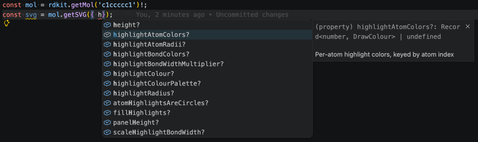

# RDKit-ESM

RDKit minimal lib for the modern web.


## About

> A scientific library for Cheminformatics (depict, search, compare, process molecular data). Same features as the RDKit.js library, distributed as a standard ES module for modern development environments (install from npm, import in your code). Type safety for every method and parameters, autocomplete and documentation in your IDE.

RDKit ESM is a wrapper around [RDKit-js](https://www.rdkitjs.com/), the official JavaScript distribution of RDKit's main functionalities.
Based on the same MinimalLib Web Assembly (WASM) binary, it simplifies writing code by wrapping all the conversions for the user: no need for manually serializing and deserializing JSON strings to interact with the raw WASM API, you get a direct TypeScript interface with full autocomplete and compile-time validation of every option. No need to build specific object like MolList: regular JS arrays of Mol objects can be used instead.



**Features:** molecule parsing, substructure search, molecular descriptors, fingerprints (Morgan, MACCS, pattern, ...), reactions, Maximum Common Substructure, R-group decomposition, SVG and Canvas rendering.

## Acknowledgment

This library is based on the RDKit project and its RDKit-js distribution. We thank the RDKit community for their contributions,
in particular Michel Moreau and Paolo Tosco for maintaining the MinimalLib and the RDKit-js distribution. The original types
definitions in RDKit-js had been written by Ádám Baróthi.

The examples in this repository and the unit-tests are based on the code and the data in the MinimalLib repository, written mostly by Greg Landrum and Paolo Tosco.

Bindings for minimization and 3D conformer generation are based on code from [Molarium](https://molarium.org/) by Rafal Wiewiora. [Github](https://github.com/rafwiewiora/molarium)

## Quick Start

### Installation

```bash
npm install rdkit-esm
```

### Usage

```ts
import { initRDKit } from 'rdkit-esm';

// Initialization is async — await it before calling any other method
const rdkit = await initRDKit();

const mol = rdkit.getMol('c1ccccc1');
if (mol) {
  mol.getSmiles(); // 'c1ccccc1'
  mol.getDescriptors(); // { exactMW: 78.047, ClogP: 1.6816, ... }
  mol.getSVG({ width: 350, height: 300 });

  mol.delete(); // free WASM memory when done
}
```

### Important note about code bundling

If your application deployment involves a build step, the bundler requires a hint about
the WASM binary file location, so that it gets copied with the other assets (such as images).
The code will vary depending on your bundler.

With Vite.js, the initialization code will look like:

```ts
import { initRDKit } from 'rdkit-esm';
import wasmUrl from 'rdkit-esm/dist/RDKit_minimal.wasm?url'; // the `?url` part is a directive for rolldown wasm plugin

// Pass the `locateFile` function which returns the path where the WASM is located
// During the build process, Vite will replace it with the path to the assets directory
// where the WASM file has been copied to
const rdkit = await initRDKit({ locateFile: () => wasmUrl });
```

Note that using a distribution as a WASM file is the most efficient (can be compressed by the server and is processed more rapidly by the browser than a base64 encoded string).

## API Overview

### `initRDKit(options?): Promise<RDKit>`

Loads the WASM module and returns the main interface. **Must be awaited** before any other call.

### `RDKit`

The main entry point for creating molecules, reactions, and collections.

| Method                              | Description                                                                                                                                                                                                       |
| ----------------------------------- | ----------------------------------------------------------------------------------------------------------------------------------------------------------------------------------------------------------------- |
| `getMol(input, options?)`           | Create a `Mol` from strings (SMILES, V2000/V3000 Mol, CXSMILES), commonchem/RDKit JSON, RDKit pickle (as a Uint8Array). Returns `null` on invalid input or throws with the reason if `{ throwOnError }` is passed |
| `getQMol(input)`                    | Create a query `Mol` from a SMARTS string or a query Mol File.                                                                                                                                                    |
| `getRxn(input, options?)`           | Create a `Reaction` from reaction SMARTS, SMILES, or an RXN block.                                                                                                                                                |
| `getMCS(mols, options?)`            | Compute the Maximum Common Substructure across a set of molecules (`Mol[]` or `string[]`).                                                                                                                        |
| `getRGD(core, molecules, options?)` | R-Group Decomposition against one or more core structures (`Mol`, `Mol[]`, `string` or `string[]`).                                                                                                               |
| `molzip(mol1, mol2)`                | Combine two molecules using matching RGroups, labels, etc...                                                                                                                                                      |
| `version`                           | RDKit version string.                                                                                                                                                                                             |
| `createSubstructLibrary`            | Returns a Substructure Library wrapper for optimized substructure searches                                                                                                                                        |
| `configure(options)`                | General configuration options for the library, including `enableLogging`                                                                                                                                          |

### `Mol`

Wraps a single molecule with a typed, camelCase API.

- **String representations** — `getSmiles()`, `getCxSmiles()`, `getSmarts()`, `getMolblock()`, `getV3KMolblock()`, `getInchi()`, `getInchikey()`, `getJSON()`
- **Fingerprints** — `getMorganFp()`, `getMaccsFp()`, `getPatternFp()`, `getTopologicalTorsionFp()`, `getRdkitFp()`, `getAtomPairFp()` (each also available as `…AsUint8Array()`)
- **Descriptors** — `getDescriptors()` returns MW, ClogP, HBA, HBD, ring counts, etc.
- **Substructure** — `getSubstructMatch(query)`, `getSubstructMatches(query)`
- **Drawing** — `getSVG(options?)`, `drawToCanvas(canvas, ...)`
- **Coordinates** — `setNewCoords()`, `generateAlignedCoords(template, options?)`
- **Mutations** — `addHs()` / `removeHs()`, `convertToAromaticForm()` / `convertToKekuleForm()`, `combineWith()`, `zipWith()`
- **Properties** — `hasProp()`, `getProp()`, `setProp()`, `clearProp()`, `getPropMap()`
- **Info** — `isDeleted`, `numAtoms`, `numHeavyAtoms`, `numBonds`, `hasCoords()`, `getStereoTags()`

### `MolArray`

Extends `Array<Mol>` with batch lifecycle management. Returned by `getFrags()`. Call `.delete()` to free all contained molecules at once. Supports all standard array methods (indexing, iteration, `map`, `filter`, ...).

### `Reaction`

| Method                                  | Description                                                   |
| --------------------------------------- | ------------------------------------------------------------- |
| `runReactants(reactants, maxProducts?)` | Run the reaction on a set of reactants. Returns product sets. |
| `getSVG(options?)`                      | Render the reaction as SVG.                                   |
| `drawToCanvas(canvas, ...)`             | Draw the reaction to an HTML canvas.                          |

## Memory Management

RDKit objects live in WASM memory and **must** be freed explicitly to avoid leaks. Call `.delete()` on every `Mol`, `MolArray`, and `Reaction` when you are done with it.

```ts
const mol = rdkit.getMol('CCO');
// ... use mol ...
mol?.delete();
```

All classes also implement the `Disposable` interface. In environments that support `using` declarations (Node.js 22+, or TypeScript with downlevel emit), you can let scope exit handle cleanup automatically — note that this is not yet widely supported in browsers.

```ts
using mol = rdkit.getMol('CCO')!;
// mol is deleted automatically when the scope exits
```

## License

[MIT](LICENSE)
